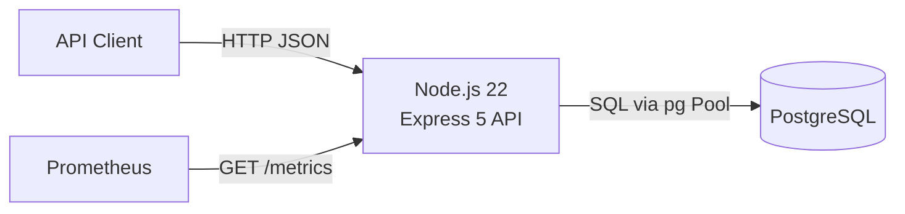
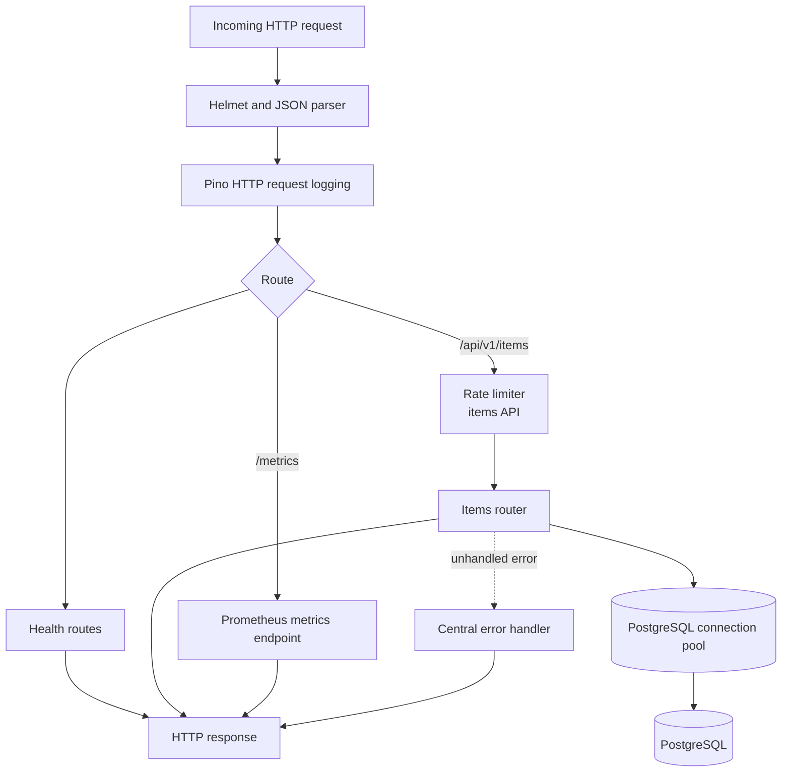
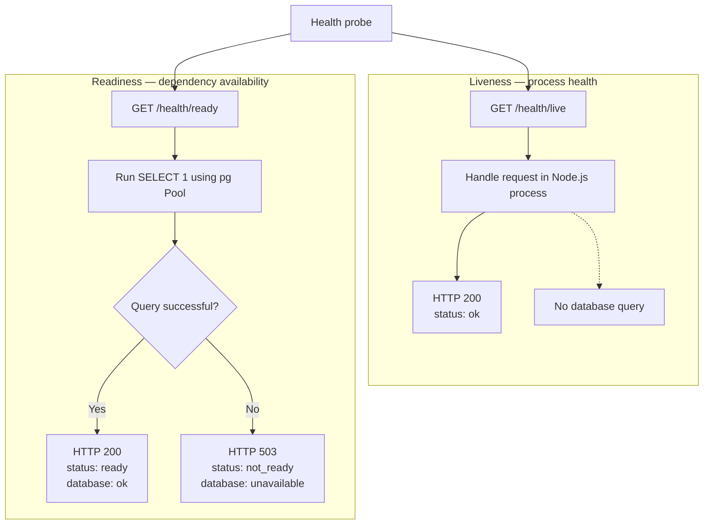
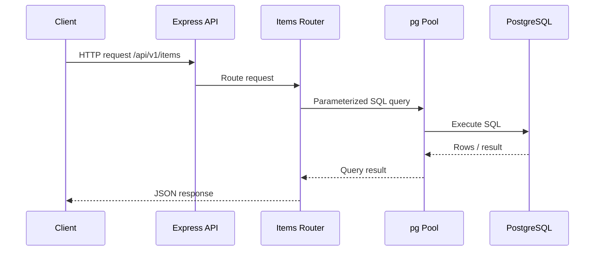
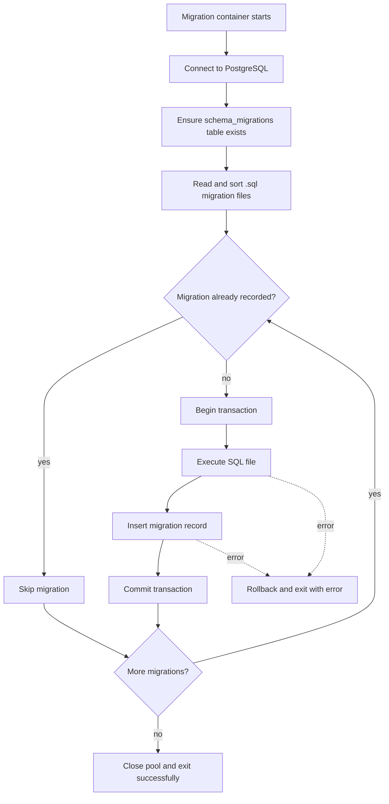
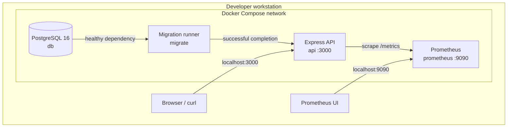
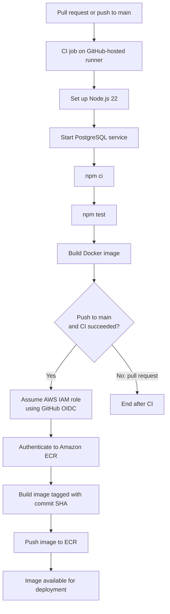

# Node.js API — Architecture

This document describes the API runtime, data flow, local container topology, and CI/CD pipeline implemented in this repository.

## 1. System context

The service is a containerized Express API backed by PostgreSQL. It exposes a versioned item resource API and operational endpoints for health checks and Prometheus scraping.

## 2. Application component architecture

The application is composed in `src/app.js`. The HTTP listener and process lifecycle are handled separately in `src/server.js`, which closes the HTTP server and PostgreSQL pool on SIGTERM or SIGINT.

## 3. Request and data lifecycle

### Readiness and liveness

These are two independent probes with different responsibilities:

- **Liveness — `GET /health/live`:** verifies that the Node.js process can handle an HTTP request. It does not query PostgreSQL. If it responds, the endpoint returns `200` with `{ "status": "ok" }`.
- **Readiness — `GET /health/ready`:** verifies that the instance can reach PostgreSQL by executing `SELECT 1`. A successful check returns `200` with database status `ok`; a failed query returns `503` with database status `unavailable`.

A liveness failure indicates that the process is not responding and may need to be restarted by its orchestrator. A readiness failure indicates that this instance should temporarily stop receiving traffic; it does **not** necessarily mean the process should be restarted. For example, PostgreSQL may be temporarily unavailable while the Node.js process itself remains healthy.

### Item resource flow

The item endpoints use parameterized SQL. The route validates the item identifier and create payload, returns `404` for missing items, and forwards unexpected failures to the centralized error handler.

## 4. Database migration lifecycle

Each migration is recorded only after its SQL executes successfully inside the transaction. The migration service is a one-shot Compose service; the API waits for that service to complete successfully before starting.

## 5. Local Docker Compose topology

Compose exposes PostgreSQL on host port 5432, the API on port 3000, and Prometheus on port 9090. The database uses a named volume for local persistence.

The dependency conditions are intentional:

- The migration service waits for PostgreSQL's `pg_isready` health check.
- The API waits for the migration service to exit successfully.
- Prometheus starts after the API container has started and scrapes it every 15 seconds.

## 6. Observability model

The API exposes a Prometheus registry at `/metrics`.

| Metric | Type | Labels / purpose |
|---|---|---|
| `http_requests_total` | Counter | Method, Express route template, status code |
| `http_request_duration_seconds` | Histogram | Method, Express route template, status code |
| Default Node.js metrics | Various | Runtime and process measurements |

The request metrics middleware excludes `/health`, `/health/*`, and `/metrics`. It uses route templates instead of raw URL paths, avoiding labels that vary for every item ID.

Pino logs requests with a request ID. The ID is returned to clients in the `X-Request-ID` header, which can be used to correlate client reports with application logs.

## 7. CI/CD: GitHub Actions to Amazon ECR

### CI job

The workflow runs on pull requests targeting `main` and pushes to `main`. It installs dependencies, starts a PostgreSQL service, executes the Node.js test suite, and verifies that the Docker image builds.

### Publish job

The publish job depends on CI and is restricted to push events on `main`. It receives the GitHub Actions `id-token: write` permission and assumes an AWS IAM role through OIDC. It then logs into ECR and publishes an image tagged with the full Git commit SHA.

The configured region is `us-east-1` and the ECR repository is `prod-ready-aws-api`. The registry repository and IAM role are prerequisites; the workflow does not provision them.

## 8. Runtime container design

The Dockerfile uses a multi-stage build:

1. A dependencies stage installs production-only npm dependencies.
2. A separate runtime stage copies the application source, migrations, package metadata, and production dependencies.
3. A dedicated non-root Linux user owns and runs the application.
4. The process starts with `node src/server.js` and listens on port 3000 by default.

The application handles SIGTERM and SIGINT by closing the HTTP listener and PostgreSQL pool, allowing a more orderly container shutdown.

## 9. Current limitations and recommended improvements

The architecture is a useful reliability-oriented foundation, but these items should be addressed before treating it as production-hardened:

- Normalize `NODE_ENV=Production` in the Dockerfile to the conventional lowercase `production`.
- Review the app middleware stack: it currently registers an inline `pino-http` instance as well as the configured request logger.
- Align the PostgreSQL version in CI (currently 15) with local Compose (currently 16).
- Run migrations in CI and add integration tests that exercise a real PostgreSQL database.
- Add Docker health checks for the API and a deployment environment that consumes readiness/liveness.
- Restrict access to the Prometheus endpoint in deployed environments.
- Pin image base layers by digest and add image vulnerability scanning, SBOM generation, and provenance.
- Add a controlled ECS or EKS deployment stage with rollout monitoring and rollback.

The current workflow publishes a container image; it does not deploy that image to a running service.
